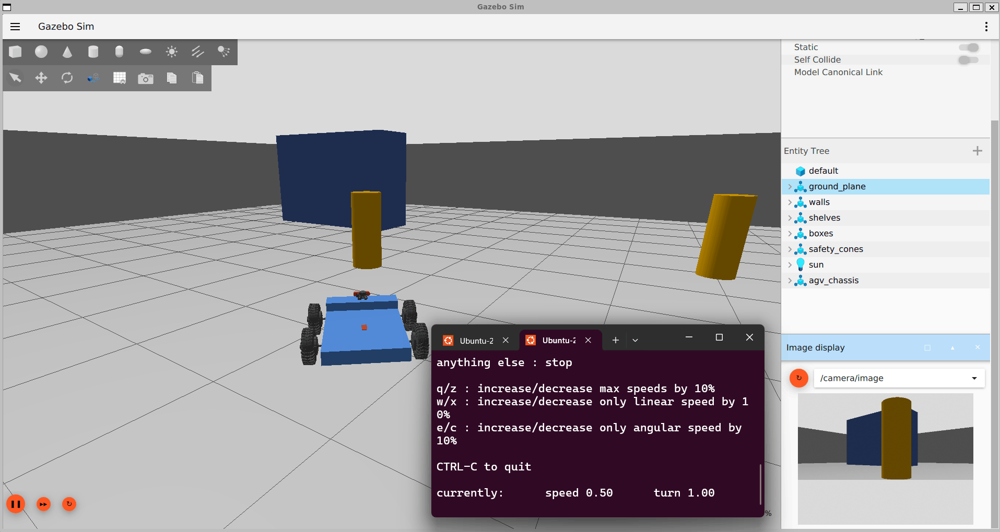

# ROS 2 Humble Warehouse AGV Robot Simulation in Gazebo: SLAM Mapping, YOLO Object Detection and Nav2 Autonomous Navigation

    

**Robotics simulation project by a freelance robotics and computer vision engineer.** A 4-wheel AGV (automated guided vehicle / warehouse robot) that builds a 2D map with **LiDAR SLAM**, recognises objects with a custom-trained **YOLO** model, and drives itself to goals with **Nav2** while avoiding obstacles. Built with **ROS 2 Humble, Gazebo Harmonic, slam_toolbox, Nav2, AMCL, PyTorch and Ultralytics YOLO**.

## 🎥 AGV Warehouse Simulation Demo

[](https://www.youtube.com/watch?v=JZUNnCf23p0)


---

## 📸 Project Screenshots and Demonstrations

The following screenshots are displayed vertically, one below another, using the full available width of the GitHub README.

### 1. Teleoperation — Manual Robot Control

The AGV can be controlled manually using keyboard teleoperation, allowing the operator to move the robot forward, backward, and rotate left or right within the simulated warehouse environment.



### 2. SLAM Mapping and Robot Visualization

The robot uses LiDAR sensor data to generate a 2D map of its surroundings. RViz visualizes the map, robot position, sensor data, and coordinate frames.


### 3. YOLO Object Detection

A custom-trained YOLO model detects warehouse objects such as boxes, cylinders, and shelves from the simulated camera feed.


---

## Features

- **Gazebo warehouse simulation**: custom 20 x 20 m world with shelves, boxes and cylinders, plus a URDF/xacro 4-wheel skid-steer AGV with LiDAR, depth camera and IMU
- **Teleoperation** with the keyboard
- **SLAM mapping** with `slam_toolbox` and map saving with `nav2_map_server`
- **Object detection**: custom YOLO model (`Box`, `cylinder`, `shelf`) running live on the simulated camera.
- **Autonomous navigation** with Nav2 (AMCL localization, costmaps, DWB controller) and goals set from RViz, the terminal or a Python script
- **ROS 2 - Gazebo bridge** (`ros_gz_bridge`) for clock, odometry, LiDAR, camera, IMU, TF and joint states

## Tested on

Ubuntu 22.04 (including WSL2), ROS 2 Humble, Gazebo Harmonic, NVIDIA GTX 1650, Python 3.10.

## Project structure

```
agv_chassis_description/   ROS 2 package: URDF/xacro, Gazebo world, bridge, SLAM + Nav2 + YOLO launch files,
                           scripts/yolo_detector.py (ROS 2 node) and models/best.pt (custom YOLO model)
agv_nav/                   goto_goal.py (send goals), calibrate_rotation.py (odometry check)
tools/                     frame_saver.py (record training images), environment check scripts
training/                  Kaggle notebook to train the YOLO detector
maps/                      saved SLAM map (warehouse_map.yaml + .pgm)
media/                      project reports and demo media
```

## 1. Installation

```bash
# ROS 2 Humble + Gazebo Harmonic bridge (see the ros_gz README for the Humble + Harmonic combination)
sudo apt install -y ros-humble-ros-gzharmonic ros-humble-xacro ros-humble-rviz2 ros-humble-joint-state-publisher-gui \
  ros-humble-slam-toolbox ros-humble-navigation2 ros-humble-nav2-bringup ros-humble-nav2-simple-commander \
  ros-humble-nav2-map-server ros-humble-teleop-twist-keyboard ros-humble-rqt-image-view

# Clone into a colcon workspace and build
mkdir -p ~/ros2_ws/src && cd ~/ros2_ws/src
git clone https://github.com/YOUR_USERNAME/ros2-gazebo-agv-warehouse-slam-yolo-nav2.git
cd ~/ros2_ws && PYTHONNOUSERSITE=1 colcon build --packages-select agv_chassis_description
source install/setup.bash
export REPO=~/ros2_ws/src/ros2-gazebo-agv-warehouse-slam-yolo-nav2
```

Every new terminal: `source /opt/ros/humble/setup.bash && source ~/ros2_ws/install/setup.bash`.

## 2. Teleoperation (keyboard control)

```bash
# Terminal 1: Gazebo warehouse + robot + RViz
ros2 launch agv_chassis_description gazebo.launch.py

# Terminal 2: drive the robot (i = forward, j/l = turn, k = stop, z = slower)
ros2 run teleop_twist_keyboard teleop_twist_keyboard
```

In RViz set **Fixed Frame** to `odom` if no map is running yet.

## 3. SLAM Mapping (slam_toolbox)

```bash
# Terminal 1: simulation (as above)
ros2 launch agv_chassis_description gazebo.launch.py

# Terminal 2: teleoperate slowly and cover the whole warehouse
ros2 run teleop_twist_keyboard teleop_twist_keyboard

# Terminal 3: start SLAM
ros2 launch slam_toolbox online_async_launch.py slam_params_file:=$(ros2 pkg prefix agv_chassis_description)/share/agv_chassis_description/config/mapper_params_online_async.yaml use_sim_time:=true
```

In RViz set **Fixed Frame** to `map` and add **Map** (`/map`, durability *Transient Local*). When the map is complete, save it:

```bash
mkdir -p $REPO/maps
ros2 run nav2_map_server map_saver_cli -f $REPO/maps/warehouse_map
```

Stop SLAM before navigation.

## 4. Object Detection (YOLO)

```bash
# One-time: Python environment
sudo apt install -y python3-venv python3-pip
python3 -m venv --system-site-packages ~/yolo_env
echo 'export PYTHONNOUSERSITE=1' >> ~/yolo_env/bin/activate
source ~/yolo_env/bin/activate
pip install -U pip wheel 'numpy<2'
pip install torch torchvision --index-url https://download.pytorch.org/whl/cu126
pip install ultralytics 'numpy<2'
deactivate

# Terminal 1: simulation
ros2 launch agv_chassis_description gazebo.launch.py

# Terminal 2: YOLO detector (use gpu_id:=-1 for CPU)
ros2 launch agv_chassis_description yolo_detector.launch.py

# Terminal 3: view the detections
ros2 run rqt_image_view rqt_image_view   # choose /detections/image
```

Topics: `/detections/image` (camera with boxes) and `/yolo/detections` (JSON: class, confidence, pixel box).

## 5. Autonomous Navigation + YOLO (Nav2)

```bash
# Terminal 1: simulation + RViz
ros2 launch agv_chassis_description gazebo.launch.py

# Terminal 2: Nav2 with the saved map (SLAM must not be running)
ros2 launch agv_chassis_description navigation.launch.py map:=$REPO/maps/warehouse_map.yaml

# Terminal 3: live YOLO object detection
ros2 launch agv_chassis_description yolo_detector.launch.py
```

**Set a goal** (the robot starts at the map origin, so the initial pose is already set):

- **RViz**: click **2D Goal Pose**, then click and drag on the map
- **Terminal**: `ros2 topic pub --once /goal_pose geometry_msgs/PoseStamped '{header: {frame_id: map}, pose: {position: {x: 4.0, y: -3.0}, orientation: {w: 1.0}}}'`
- **Python script**: `python3 $REPO/agv_nav/goto_goal.py 4 -3 0` (x, y, yaw in degrees)
- **Waypoints**: `python3 $REPO/agv_nav/goto_goal.py --waypoints '4,-3,0; -6,6,90; 0,0,0'`

Nav2 avoids obstacles with LiDAR costmaps (static map + live `/scan`); YOLO adds object recognition on the camera view.

## Train your own YOLO detector

1. Record images: `python3 $REPO/tools/frame_saver.py --ros-args -p use_sim_time:=true -p session:=layoutA -p out_dir:=$HOME/dataset/raw`
2. Annotate (Roboflow, CVAT or Label Studio) and export in YOLO detection format
3. Train with `training/warehouse_yolo_kaggle_train.ipynb` on any GPU, then copy `best.pt` to `agv_chassis_description/models/` and rebuild

## Troubleshooting

- **Simulation is slow**: use the NVIDIA GPU in WSL2 (`export MESA_D3D12_DEFAULT_ADAPTER_NAME=NVIDIA`), close extra Gazebo panels, run Gazebo with `-s`
- **`colcon build` fails with `canonicalize_version`**: build with `PYTHONNOUSERSITE=1`
- **YOLO environment problems**: run `python3 tools/check_yolo_env.py`

## 💼 Robotics and Computer Vision Engineering

I am available for freelance projects involving **Robotics, ROS 2, Gazebo simulation, SLAM, Nav2 autonomous navigation, LiDAR, YOLO, computer vision, and mobile robot development**.

Feel free to contact me to discuss your robotics or computer vision project.

- **Email:** [kavathiyahet25@gamil.com](mailto:kavathiyahet25@gamil.com)
- **LinkedIn:** [Het Kavathiya](https://www.linkedin.com/in/het-kavathiya-922a692aa)
- **Upwork:** [View My Upwork Profile](https://www.upwork.com/freelancers/~012293e09d67cf37c7?mp_source=share)
- **GitHub:** [HetKavathiya](https://github.com/HetKavathiya)

## Keywords

ROS 2, ROS 2 Humble, Gazebo Harmonic, robotics simulation, AGV, warehouse robot, SLAM, slam_toolbox, Nav2, autonomous navigation, AMCL, LiDAR, YOLO, object detection, computer vision, mobile robot, obstacle avoidance, URDF, RViz, ros_gz_bridge.

## License

This project is intended to use the MIT License. Add a LICENSE file to the repository if you choose this license, and ensure that it is appropriate for the code and assets included.
